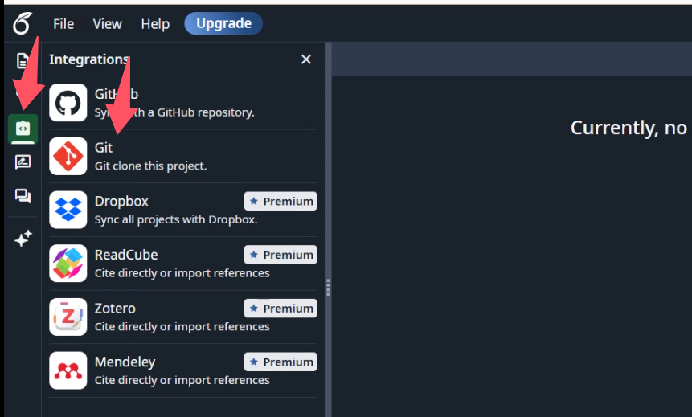
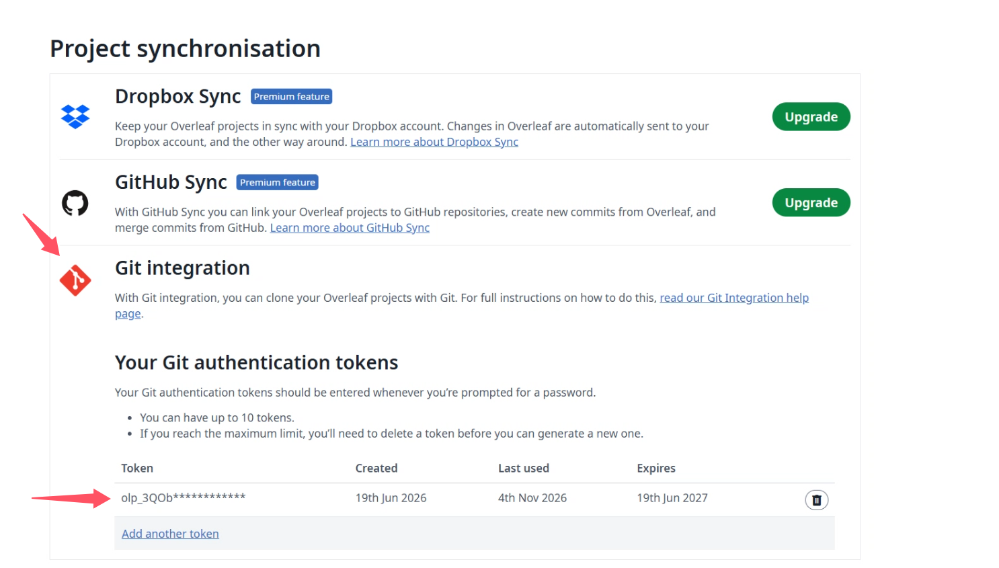

# Overleaf Git 同步

## 首次添加后立即开始引导

当 agent 正在为用户首次添加/安装本技能，或宿主在添加后首次加载本技能并交给 agent 执行时，不要只回复“已安装，使用时再叫我”，也不要等待用户再说“开始设置”。直接告知：“技能已添加。现在开始首次设置，我先检查电脑是否安装 Git；之后会一步一步带你填写项目地址、保存位置和署名。”接着执行下方第 1 步的只读 Git 检查，再按顺序继续。若缺少 Git，说明安装来源和下一步，遵守已有授权和宿主安装权限；主动开始引导不等于可以绕过安装权限、代填秘密或自动上传论文。

如果由安装 agent 安装本技能，应在安装完成后读取本文件并接续引导；如果必须刷新或重启宿主才能加载，准确说明该要求，在可继续的首次加载时开始。`allow_implicit_invocation: true` 允许自动选择技能，`default_prompt` 提供启动提示，但两者都不应被当作安装事件回调。仅把文件复制进目录、而宿主没有启动或通知 agent 时，本技能不能自行运行；不要承诺后台自动执行。

用户明确说“只安装”“暂不设置”“稍后”，或已有配置可直接使用时，尊重该意图，不强制重跑。暂停后按当前聊天记录和实际配置续接，避免重复询问。单纯审阅、修改、发布本技能属于维护工作，不是首次安装，不要启动 Overleaf 论文设置。不要为判断首次使用擅自写入跨会话记忆或后台任务。

用中文引导用户完成所请求的阶段。先读目标目录的 AGENTS.md，确认项目、目录、远端和同步方向；已有授权继续有效。创建技能或索取教程本身不授权实际安装软件或上传论文。不要把某个项目允许丢弃本地修改的约定推广到其他项目。

## 首次设置：一次只做一步

首次使用时按下面顺序引导，不再一次索取地址、署名和位置等多项信息。每一步用简单语言说明“去哪里、做什么、回复什么”，等该步必要信息齐全再继续。已提供的信息和已确认适用的配置直接复用，不重复询问。agent 负责命令操作，用户只负责选择、登录和输入秘密。优先使用可用的交互提问工具，一次只问当前一步。

1. **检查 Git**：告知“我先检查这台电脑是否装好 Git，它负责在电脑和 Overleaf 之间传文件，你暂时不用填信息。”按后文安装流程执行，完成后告知结果。
2. **项目地址**：展示 `assets/overleaf-project-git.png`。引导“打开要同步的 Overleaf 论文 → 左侧 Integrations → Git → 复制 Git 地址发给我。只需要地址，不要密码；整条 git clone 命令也可以。”说明 `https://git@git.overleaf.com/项目ID` 只是格式示例，不可照抄。若用户给的是论文页面链接，帮助定位对应 Git 地址；若给整条命令，只提取和检查地址，不执行任意粘贴命令。没有 Git 入口时检查项目权益，不引导购买无关的 GitHub Sync。
3. **保存位置**：单独询问“你想把论文放在哪个文件夹？可以提供完整路径；不确定的话，我建议放到文档目录中新建的 OverleafProjects/项目名 文件夹。”从当前电脑解析实际用户目录，展示建议的最终绝对路径供选择，不能照抄截图中的用户名或目录。说明父目录和项目目录的区别；检查目标是否存在、是否为空、是否已有仓库，不覆盖现有文件或多套一层同名目录。位置未明确时等待选择。
4. **提交姓名**：读取适用的 `user.name`，已有配置可告知沿用；缺失时只问“以后上传修改时，你希望记录哪个名字作为署名？中文或英文都可以，这不是 Overleaf 登录名。”记录回答，不猜测。仓库尚未克隆时暂不执行 `--local`。
5. **提交邮箱**：读取适用的 `user.email`，已有配置可沿用；缺失时只问“提交记录使用哪个邮箱？邮箱会写入版本记录，可使用你希望展示的邮箱或已有隐私邮箱，不必与 Overleaf 登录邮箱相同。”不猜测或编造 noreply 地址。默认只设置当前论文仓库，只有用户要求所有仓库共用时才改全局配置。
6. **认证令牌**：展示 `assets/overleaf-account-tokens.png`。引导“打开账户设置 → Project synchronisation → Git integration → Your Git authentication tokens → Add another token 或 Generate token。新 token 就是 Git 提示 Password 时要输入的内容，请保存在自己电脑上，不要发给我；准备好后回复‘已准备好’。”已有可用凭据或 token 时复用，无需生成新的。截图中的掩码行只表示旧令牌位置，不能取回完整旧令牌。按后文截图展示规则嵌入图片。
7. **下载与写入署名**：用已确认的地址和最终目录 clone；用户名为 `git`，token 由用户在本机认证窗口输入。工具无法提供交互输入时，给出已填好地址和目录的单条命令，让用户在本机执行，然后继续检查。下载成功后才进入新仓库，按第 4、5 步配置仓库级署名；检查实际生效值。不能把“令牌已准备好”当成认证成功。
8. **选择是否验证上传**：先告知下载结果、实际目录、分支和署名；然后单独提出下方选项。命令结果和下载完整性检查始终执行，可选的是会修改远端的上传测试。仅 clone 成功不能宣称上传已验证。

### 最后一步：可选的上传验证

询问：“下载已完成。要不要验证一次上传？我会在主 tex 文件的安全位置单独加一行 `%` 注释，上传并核对 Overleaf。它不会显示在正文中，但会留下一条提交记录。”提供三个选项：

- **跳过上传验证（默认）**：不改论文、不建测试提交；报告“下载已验证，上传未测试”。
- **验证上传，保留注释**：添加一行独立 `%`，提交、上传、核对后保留。
- **验证上传后清理注释**：验证成功后仅删除本次新增行，再提交和上传；明确会留下两次提交记录。

等待用户选择；未回复、稍后或跳过不能视为写入授权，不执行测试，也不阻碍设置完成。用户已经明确要求“加个 % 并上传验证”时直接按保留注释执行，无需重复确认；已明确要求清理则执行第三项。单纯请求设置同步不授权此测试。

选择验证后按以下流程执行：

1. fetch 并检查远端变化、工作树和暂存区，先安全同步。存在无关改动时保留，不能混入测试或为测试 reset/clean；可在独立干净副本验证，无法隔离时报告阻碍。
2. 确认实际主 `.tex` 文件，不能默认一定叫 `main.tex`。阅读源码，在顶层完整命令之间的安全空白处添加一行单独的 `%`，优先正常 `\begin{document}` 前的安全位置。保留编码、换行和 `% !TeX` 指令。不放在正文行末、命令参数、verbatim/listings/minted 环境或特殊 catcode 区域；无法确认安全位置时停止并说明。
3. 检查 diff，必须只有这一行新增；执行 `git diff --check`。只暂存目标文件，检查暂存内容没有其他改动，提交 `test: verify Overleaf Git upload`，按后文上传流程普通 push，禁止强推。不编译、不改正文。
4. 核对远端分支已包含测试提交，并 fetch 后读取远端该文件，确认新增行存在；记录插入位置与提交 SHA。远端并发推进时检查提交祖先关系，不仅比较 HEAD 相等。遇到冲突先协调，不能丢弃别人修改。
5. 选择清理时再次 fetch，只删除本次新增注释，提交 `test: remove Overleaf Git verification comment` 并上传核对；不 reset 历史。源文件漂移、不能唯一定位或出现冲突时停止清理并报告，不能删错已有 `%`。
6. 如实区分下载成功、上传成功、远端核对成功和清理成功。失败时说明处于“本地已改未提交 / 已提交未上传 / 已上传待核对 / 清理失败”的哪一步，注释是否仍在远端；重试不重复累加测试行。

## 操作参考：安装与设置 Git

先执行 `git --version`。Windows 若命令不存在，检查已安装程序和 PATH，避免重复安装。需要安装时使用 Git 官方安装包，或：

```powershell
winget install --id Git.Git -e --source winget
```

winget 包由社区维护；官方安装入口见文末。安装后重新打开终端并验证版本。macOS/Linux 使用相应平台官方安装说明，不在已有 Git 时升级整个系统。

提交前检查 `git config --get user.name` 和 `git config --get user.email`；缺失时让用户提供提交署名，不猜测身份。优先在仓库内设置，仅在用户希望所有仓库共用时使用 `--global`：

```powershell
git config --local user.name '用户提供的姓名'
git config --local user.email '用户提供的邮箱'
git config --show-origin --get-all credential.helper
```

Git 提交署名与 Overleaf 登录身份不同。不要无故修改全局换行符、代理或凭据配置。Windows 优先复用 Git Credential Manager/系统凭据存储；先检查 `git credential-manager --version`，只有已安装且需要设置时才按该版本官方说明配置。不要使用明文 `credential.helper store` 保存 token。

## 操作参考：地址、认证与截图

### 首次设置时主动展示截图

用户首次连接 Overleaf、首次设置 Git 认证，或不知道设置入口时，agent 必须在面向用户的回复中展示下列截图，并结合当前步骤解释箭头位置；不能只在内部查看图片或仅给出文件路径。日常已配置好的拉取/推送不重复展示，除非用户需要定位入口。

- 在“项目地址”步骤展示 `assets/overleaf-project-git.png`：请用户打开自己的 Overleaf 项目，点击左侧箭头所指的 **Integrations** 图标，再点击面板中的 **Git**（不是上方的 GitHub），获取项目的 Git 地址。
- 在“认证令牌”步骤展示 `assets/overleaf-account-tokens.png`：请用户打开 [Account Settings](https://www.overleaf.com/user/settings)，找到 **Project synchronisation → Git integration → Your Git authentication tokens**；点击 **Add another token** 或当前界面对应的生成按钮。图中的掩码 token 行只是已有令牌列表的位置示例，不是可复制使用的密码，也不能点击该行取回完整旧令牌。新令牌由用户自行保存并在本机认证提示中输入，不发送到聊天。

截图是随技能分发的资源。展示时以当前 `SKILL.md` 所在目录为根解析上述相对路径，在支持本地图片的客户端使用 `` 嵌入；必须替换成实际安装路径，不写死作者电脑路径，不把占位路径原样发给用户。若客户端仅支持托管图片，使用下方仓库图片链接嵌入；若图片无法内联显示，说明限制并提供可点击的图片链接和对应文字步骤，不声称已展示成功。





托管图片备用地址：
- https://raw.githubusercontent.com/Liuyun1005/overleaf-sync/main/assets/overleaf-project-git.png
- https://raw.githubusercontent.com/Liuyun1005/overleaf-sync/main/assets/overleaf-account-tokens.png

这些截图仅用于定位控件，不代表使用者的账户、订阅状态、令牌数量或有效期。界面改变时按实际标签和官方文档引导；不要依据示例中的 Upgrade 按钮让用户购买无关的 GitHub Sync 或 Dropbox 功能。

Overleaf Cloud 的 Git 集成需要项目具备对应权益；学校订阅可能提供权益，以项目实际可见功能为准。Server Pro 还取决于管理员配置。Git 同步与 GitHub 同步不是同一功能，不要求用户创建 GitHub 仓库。

1. 请用户登录 Overleaf 并打开目标项目，在左侧 **Integrations → Git** 中复制 Git 地址；旧界面可能在 Menu 中。优先复用登录会话；操作浏览器时遵守可用浏览器工具的使用说明。
2. 在 Git 对话框选择 **Generate token**，或进入 [Account Settings](https://www.overleaf.com/user/settings) 的 Git authentication tokens 区域生成令牌。
3. 认证用户名为 `git`；Password 提示处输入该 token，**不是网页登录密码**。旧 token 全文不能再次显示，遗失时生成新的 token。学校 SSO 用户也使用 token。
4. 由用户直接在本机交互式终端或凭据窗口输入 token，不要求粘贴到聊天。若工具无法安全提供交互输入，给出需在本机执行的命令，待用户完成后继续验证。不要把 token 写进 URL、命令参数、脚本、日志或技能文件；不要读取或输出系统保存的凭据。

Cloud 地址通常为 `https://git@git.overleaf.com/项目ID`；自托管地址从实际界面复制，不能硬套 Cloud 域名。检查已有 remote 时避免输出可能嵌入的密码，报告中脱敏。页面入口、权益和 token 有效期可能变化，遇到不一致时查文末官方说明。

## 操作参考：首次获取文件

将以下示例中的地址和目录替换成已确认的值；不要直接执行示例占位内容。

```powershell
git clone 'https://git@git.overleaf.com/项目ID' '目标目录'
Set-Location '目标目录'
git status --short
git branch -vv
git remote -v
git ls-remote --symref origin HEAD
git rev-parse HEAD
```

目标应为不存在或空目录；已有文件时先检查，不覆盖，也不在已有仓库内重新 `git init`。已有本地论文但没有远端历史时，先将 Overleaf 克隆到独立目录，再把用户指定源码复制进去、审查差异并提交；不要上传外层项目或 `.git`。

检查实际分支：新项目通常为 `main`，旧克隆可能为 `master`；不能静默切换分支或替换已有 remote。保留嵌套仓库历史，在论文子仓库内运行 Git。下文命令假定已核实远端 `origin` 和分支 `main`，否则替换成实际值。

## 操作参考：获取远端更新

每条命令成功后才进行依赖它的下一步；PowerShell 不应在失败后继续执行写操作。

```powershell
git status --short
git branch -vv
git rev-parse HEAD
git fetch origin
git log --oneline HEAD..origin/main
git diff --stat HEAD origin/main
git diff --name-status HEAD origin/main
```

`fetch` 只获取远端引用，不更新本地文件。记录起始提交，检查本地修改、未跟踪文件和本地独有提交。工作树干净且 HEAD 为远端祖先时：

```powershell
git merge --ff-only origin/main
```

若仅本地领先，不必合并；“下载更新”不授权上传这些提交。若存在本地修改或分叉，默认保留，检查差异后按用户意图处理；不要自动 stash、reset、clean 或覆盖冲突。可以先用独立快照检查远端。只有用户或适用项目规则已明确授权以远端覆盖时，才在核实目录、remote、分支和将丢弃内容后使用 `git reset --hard origin/main`。不要清理无关未跟踪文件。审核任务有更严格的只读要求时遵守该要求。

验证 HEAD、远端 SHA、`git diff --exit-code origin/main --` 和 `git status --short`。完全镜像同步应提交相同且已跟踪文件无差异；保留本地内容的同步须明确说明差异。同步源码不授权编译、改写正文或推送。

## 操作参考：提交与上传

用户明确要求上传时执行，无需重复索取已有授权。先 fetch 并检查远端新变化，再编辑；若上传的是已有本地改动，保留这些待上传改动，不套用“下载时丢弃本地”的规则。合并并发变化时保留双方内容，技术含义不明确的冲突交给用户决定。

```powershell
git diff --check
git diff -- main.tex
git add -- main.tex
git diff --cached --stat
git diff --cached
git commit -m 'paper: update authorized manuscript content'
git push origin HEAD:main
git rev-parse HEAD
git ls-remote origin refs/heads/main
git status --short
```

将 `main.tex` 换为实际授权文件列表。先检查暂存区，若已有不相关内容，不将其混入本次提交，也不擅自撤销。只暂存具名文件，不默认 `git add .`；不上传凭据、缓存、编译产物、审稿 JSON 或外层 AGENTS.md。没有变化时不创建空提交。

禁止 force push。若远端推进导致拒绝，重新 fetch、检查并协调并发修改后再普通 push；无法安全解决时报告具体冲突，停止推送重试。最终核对本地提交与远端分支 SHA；若验证时远端又推进，检查本次提交是否已成为远端祖先，准确报告。

## 常见障碍与交付

- Authentication failed：核实用户名 `git`、token 有效性及缓存的旧凭据；由用户在系统凭据管理界面更新对应 Overleaf 条目，不清空所有凭据。
- Repository not found / no git access：核对 Git 地址、项目权限与权益，不将所有错误都当成密码错误。
- 网络/TLS 失败：报告具体错误，检查网络或机构代理；不要关闭 TLS 验证。
- non-fast-forward：fetch 后检查分叉，不能通过强推解决。
- Overleaf 不支持 Git LFS、远端多分支及仓库内部的 submodule；上传失败时检查实际文件限制。存在活跃批注或 Track Changes 时说明 Git 上传可能影响它们，尤其文件移动/改名，按用户意图处理。

完成后简洁报告 Git 是否可用、项目目录、远端（无秘密）、分支、前后提交、变更文件和验证结果；明确保留或丢弃了哪些本地内容。认证未完成就说明待完成步骤，不把 fetch 成功说成文件已同步，也不把 commit 成功说成已上传。

## 官方参考

核对日期：2026-11-05。认证、权益、平台安装与限制变化时重新查询：

- [Git 安装（Windows）](https://git-scm.com/install/windows)
- [Git 各平台安装](https://git-scm.com/install/)
- [Git Credential Manager](https://github.com/git-ecosystem/git-credential-manager)
- [Overleaf Git token](https://docs.overleaf.com/integrations-and-add-ons/git-integration-and-github-synchronization/git-integration/git-integration-authentication-tokens)
- [Overleaf Git 集成与限制](https://docs.overleaf.com/integrations-and-add-ons/git-integration-and-github-synchronization/git-integration)
